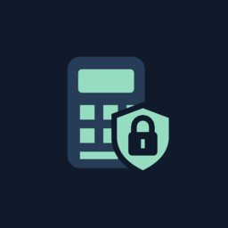

<p align="center"></p>

<h1 align="center">Allowance Privacy</h1>

<p align="center"><a href="README.md">Español</a> · <b>English</b></p>

Privacy-focused Android fork of [Allowance](https://github.com/jameskokoska/Allowance), built to protect your financial information. It installs alongside the original app (`dev.d4vram.allowanceenhanced`) and keeps all of its budgeting features. Origin, changes and license: [FORK_NOTICE.md](FORK_NOTICE.md) (GPL-3.0).

**Fork created and maintained by [D4vRAM369](https://github.com/D4vRAM369)**, building on the original work of [James Kokoska](https://github.com/jameskokoska) and the Allowance contributors. Contact: [d4vram369@proton.me](mailto:d4vram369@proton.me) · [Telegram](https://t.me/D4vRAM369).

[](https://www.buymeacoffee.com/D4vRAM369)

If you like the base app, please support the original author too: [ko-fi.com/dapperappdeveloper](https://ko-fi.com/dapperappdeveloper).

## Download

Signed APK on the [Releases](https://github.com/D4vRAM369/AllowancePrivacy/releases) page. Each release lists the certificate and APK SHA-256 fingerprints so you can verify them.

## What it adds

- **App lock:** 6–8 digit PIN (only an Argon2id hash is stored), system fingerprint and auto-lock when you leave (immediate, 30 s, 1 min or 5 min). Growing wait after 5 failed attempts.
- **Hide amounts:** eye toggle on the home screen and a setting to show `••••` on open. Calculations and the database are unchanged.
- **Protected screen:** hidden recent-apps thumbnail (Android 13+, on by default) and optional screenshot blocking (FLAG_SECURE).
- **No network:** the release build has no `INTERNET` permission and no telemetry. Inherited purchases, reviews and promotions were removed.
- **Your data, in your files:** transaction CSV, full backup encrypted with a password (AES-256-GCM + Argon2id) and encrypted AutoBackup to a folder you choose. Excluded from Android cloud backup.
- **Edit descriptions** of transactions without touching amounts or dates.

Everything is in Settings → *Privacidad y seguridad* and *Copias y datos*. Privacy policy: [PRIVACY.md](PRIVACY.md).

## Known limits

- The local database is not encrypted: the lock protects against someone holding your unlocked phone, not against a rooted device.
- If you forget the PIN and fingerprint is off, there is no recovery: only your backups. If you lose a backup's password, it cannot be decrypted.
- A new fingerprint added to the system also unlocks the app.

## Build

Flutter 3.19.6 (Dart 3.3.4), Android SDK 34 and JDK 17.

```bash
cd budget_simple
flutter pub get
flutter test
cd android
JAVA_HOME=/path/to/jdk17 ./gradlew assembleDebug
```

`flutter build` may pick Android Studio's JDK, which is incompatible with Gradle 7.5; that is why `gradlew` with JDK 17 is used. For release builds, create your own `android/key.properties` and keystore (both ignored by Git).

The original Allowance README (in English) is kept at the end of [README.md](README.md); its links and screenshots belong to the original project.
